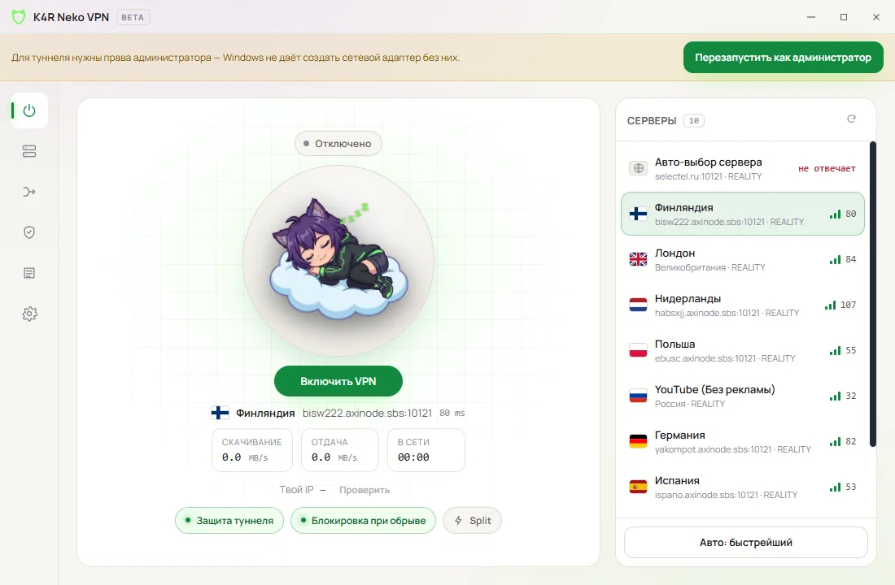
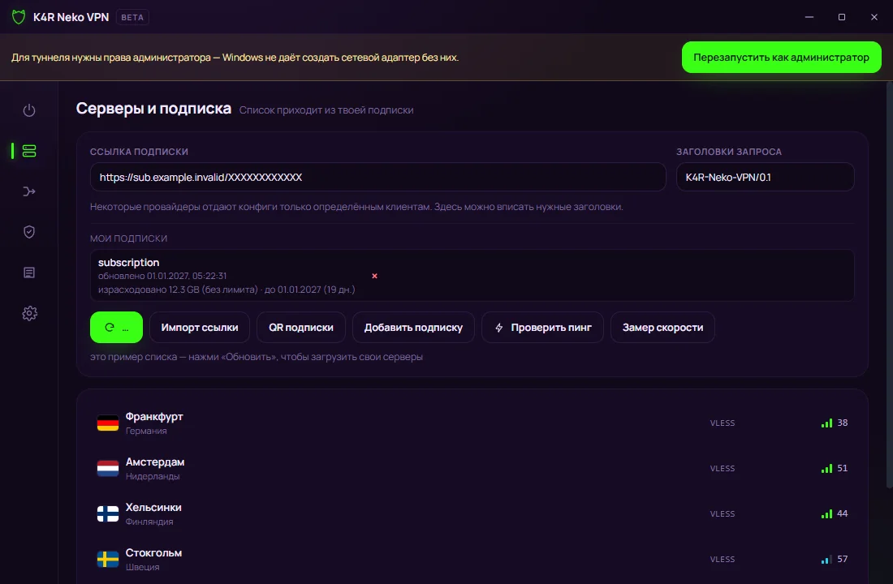
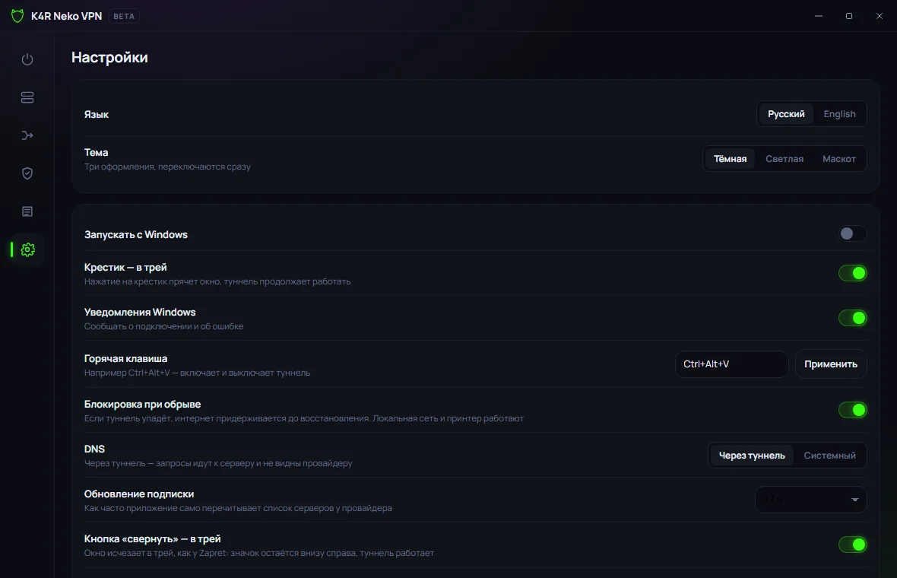
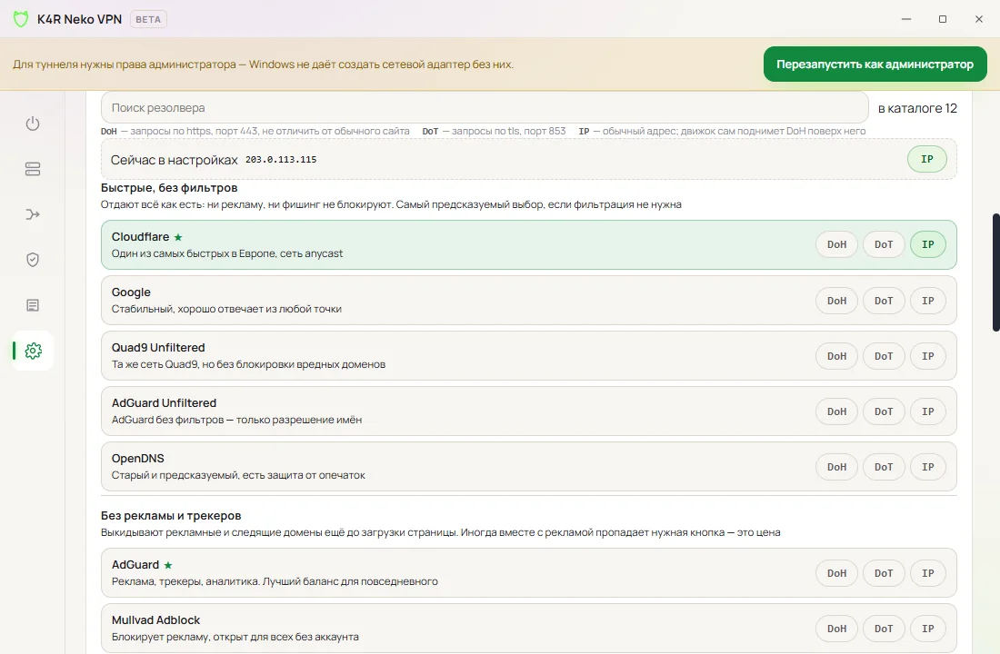

# K4R Neko VPN

Клиент для Windows с собственным туннелем на Rust: VLESS + Reality + gRPC через
sing-box, аккуратный интерфейс на React и маскот, который живёт в интерфейсе, а
не висит картинкой в углу.

> **1.2.0** — релиз для Windows. Android — рабочая сборка **0.1.0** (туннель уже
> настоящий, см. ниже). iOS — следующий.
> Что менялось: [CHANGELOG.md](CHANGELOG.md).

<p align="center">
  
</p>

<table>
  <tr>
    <td width="50%"></td>
    <td width="50%"></td>
  </tr>
  <tr>
    <td align="center"><sub>Подписки и живые серверы</sub></td>
    <td align="center"><sub>Какая программа идёт через VPN</sub></td>
  </tr>
</table>

<table>
  <tr>
    <td width="50%"></td>
    <td width="50%"></td>
  </tr>
  <tr>
    <td align="center"><sub>Настройки: темы, трей, горячая клавиша, блокировка при обрыве</sub></td>
    <td align="center"><sub>Каталог DNS: категории, поиск, DoH/DoT/IP у каждого</sub></td>
  </tr>
</table>

<p align="center">
  <sub>Все скриншоты — настоящий запущенный клиент, ссылка подписки, адреса и пути заменены на вымышленные</sub>
</p>


## Android

Тот же клиент нативно на Kotlin + Compose, ядро — тот же `sing-box`, но
библиотекой (`libbox.aar`, собран из исходников, см. `scripts/build-libbox.ps1`).
`VpnService`, разрешение на VPN, постоянное уведомление — родные API Android,
поэтому здесь нет ни WebView, ни прослойки JNI.

<table>
  <tr>
    <td width="33%"></td>
    <td width="33%"></td>
    <td width="33%"></td>
  </tr>
  <tr>
    <td align="center"><sub>Маскот, состояние, подписка, «Твой IP»</sub></td>
    <td align="center"><sub>Живой список программ с иконками</sub></td>
    <td align="center"><sub>Три темы и каталог DNS</sub></td>
  </tr>
</table>

Что уже работает: туннель VLESS/REALITY через `sing-box` (проверено на настоящей
подписке — внешний адрес меняется на адрес сервера), честное состояние
«Защищено» только после живого ответа через туннель, подписка с разбором
`subscription-userinfo`, выбор сервера, разделение по приложениям, каталог DNS,
три темы, блокировка IPv6.

Есть автозапуск после перезагрузки и плитка в шторке. Ядро собрано под `arm64`
и `amd64`, поэтому этот же APK ставится на настоящий телефон.

Есть счётчики трафика туннеля — цифры от самого ядра, не оценка.

Чего пока нет: переключателя языка внутри приложения (язык берётся из системы).

Сборка:

```
cd android
./gradlew assembleDebug     # нужен Android SDK 35, NDK не требуется
```

Перед сборкой положить `libbox.aar` в `android/app/libs/` (в репозитории его нет):
`powershell -ExecutionPolicy Bypass -File scripts/build-libbox.ps1`.

## Что это умеет

- **Туннель.** VLESS/Reality/gRPC, подписки (несколько сразу), выбор сервера,
  проверка живости серверов, авто-выбор быстрого.
- **Разделение по программам.** Два режима: «только выбранные» (в туннель идут
  лишь отмеченные программы) и «все, кроме выбранных». Локальная сеть остаётся
  локальной в любом режиме.
- **Блокировка при обрыве.** Если движок падает, поднимается «держащий» режим:
  адаптер на месте, наружу ничего не уходит, локальная сеть работает.
- **DNS с каталогом.** Четыре категории резолверов — «быстрые без фильтров»,
  «без рекламы и трекеров», «против вирусов и фишинга», «семейные», плюс свой
  адрес. У каждого три способа подключения: `DoH`, `DoT` и обычный IP.
  Есть поиск и строка «сейчас в настройках».
- **Флаги стран** в списке серверов: страна берётся из имени, которое прислал
  провайдер, а флаг — свой SVG, потому что Windows рисует флаги-эмодзи буквами.
- **Честные состояния.** «Защищено» показывается только тогда, когда движок
  действительно поднял адаптер; трафик берётся из счётчиков движка, а не
  рисуется случайными числами; сервер, который не ответил, помечается
  «не отвечает».
- **Подписка обновляется сама** — интервал 1–48 часов, серверы перепроверяются
  при каждом открытии списка, мёртвые честно помечаются.
- **Мелочи, без которых неудобно.** Автопереподключение, горячая клавиша,
  крестик и «свернуть» в трей, карточка-уведомление в углу окна, автозапуск,
  обновление подписки по расписанию (1–48 ч), экспорт журнала, три темы,
  локализация ru/en.
- **Zapret рядом, а не внутри.** Приложение не зависит от Zapret и не трогает
  чужой `winws2`: показывает его реальное состояние и оставляет чужой запуск в
  покое.

## Что проверено вживую

| Проверка | Результат |
| --- | --- |
| Программа из списка «В VPN» | выходит через VPN-адрес |
| Программа не из списка, в ту же минуту | остаётся на адресе провайдера |
| Блокировка при обрыве | наружу недоступно, локальная сеть жива |
| Переподключение после падения движка | ~2 секунды, трафик продолжается |
| Счётчики трафика | 20 МБ скачано → счётчик вырос на 20 121 810 байт |
| Сворачивание в трей | окно скрывается, процесс жив |
| Установщик | тихая установка, запуск, тихое удаление без следов |

Подробности — в `docs/ОТЧЁТ-0.4.md`, решения — в `docs/adr/`.

## Устройство

```
app/                  приложение
  src/                интерфейс: React + TypeScript, шесть экранов
  src-tauri/          ядро на Rust
    src/engine.rs     конфиг движка, запуск, надзор, блокировка при обрыве
    src/subscription.rs  разбор подписок (VLESS, base64, JSON)
    src/probe.rs      проверка живости серверов
    src/store.rs      настройки и состояние
    src/zapret.rs     чтение состояния чужого Zapret, без вмешательства
art/                  маскот и иконки: исходники, вырезание, оптимизация
docs/                 отчёты и ADR
```

Ключевые решения:

- [ADR-001](docs/adr/ADR-001-architecture.md) — почему Tauri и Rust.
- [ADR-002](docs/adr/ADR-002-split-tunneling.md) — разделение по программам.
- [ADR-003](docs/adr/ADR-003-route-order.md) — порядок правил маршрутизации.
- [ADR-004](docs/adr/ADR-004-kill-switch.md) — блокировка при обрыве без правки
  системных правил.

## Сборка

Нужны Rust (stable), Node 20+ и WebView2 (в Windows 11 уже есть).

```bash
cd app
npm install
npm run tauri dev      # разработка
npm run tauri build    # установщик NSIS и exe
```

Движок `sing-box.exe` лежит в `app/src-tauri/resources/bin/` и кладётся рядом с
приложением при сборке. Портативная версия — папка целиком, без установки.

## Тесты

```bash
cd app/src-tauri
cargo test                       # конфиг, правила, разбор подписок, хранилище
cargo run --example hold_probe      # блокировка при обрыве
cargo run --example whitelist_probe # разделение по программам
```

Пробы поднимают настоящий туннель на несколько секунд и сами его гасят.

## Приватность

Приложение не отправляет телеметрию. Наружу уходят только запросы к серверу
подписки и к самому VPN-серверу. Журнал и настройки лежат локально в
`%APPDATA%\ink.k4r.nekoneko.vpn`. В репозитории нет ни ссылок на подписки, ни
идентификаторов устройств, ни личных путей.

## Лицензия

Все права сохранены. Код открыт для чтения, но не для распространения или
переиспользования без разрешения автора.

## Движок

`sing-box.exe` в репозитории не хранится. Перед первой сборкой:

```powershell
powershell -ExecutionPolicy Bypass -File scripts/fetch-engine.ps1
```

Скрипт скачивает официальный релиз sing-box для Windows в
`app/src-tauri/resources/bin/`.
