# K4R Neko VPN

Клиент для Windows с собственным туннелем на Rust: VLESS + Reality + gRPC через
sing-box, аккуратный интерфейс на React и маскот, который живёт в интерфейсе, а
не висит картинкой в углу.

> **Windows 1.55.0**, **Android 1.35.3** (отдельный репозиторий
> [k4r-neko-vpn-android](https://github.com/Killer4Reals/k4r-neko-vpn-android)).
> iOS не планируется. Что менялось: [CHANGELOG.md](CHANGELOG.md).
>
> [Установщик Windows](https://github.com/Killer4Reals/k4r-neko-vpn-releases/releases/latest)
> · [APK для Android](https://github.com/Killer4Reals/k4r-neko-vpn-android/releases/latest)
> · [все функции списком](docs/ФУНКЦИИ.md)

<p align="center">
  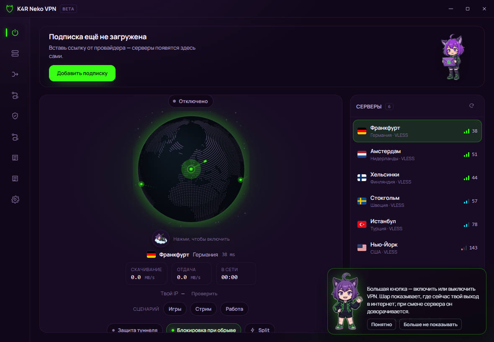
</p>

<p align="center">
  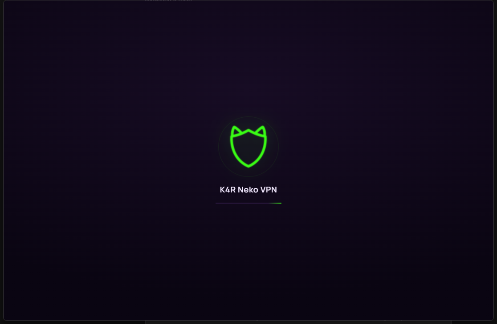
  <br><sub>Заставка 1,2 с при запуске — кадр с настоящего релиза 1.50.0</sub>
</p>

Тема одна — «Неон»: тёмный фон, неоновый акцент, маскот в углу. Цвет акцента
меняется в настройках (неон, фиолет, розовый, лёд), но набор цветов остаётся
одним, поэтому и скриншоты одинаковые по настроению:

<table>
  <tr>
    <td width="50%">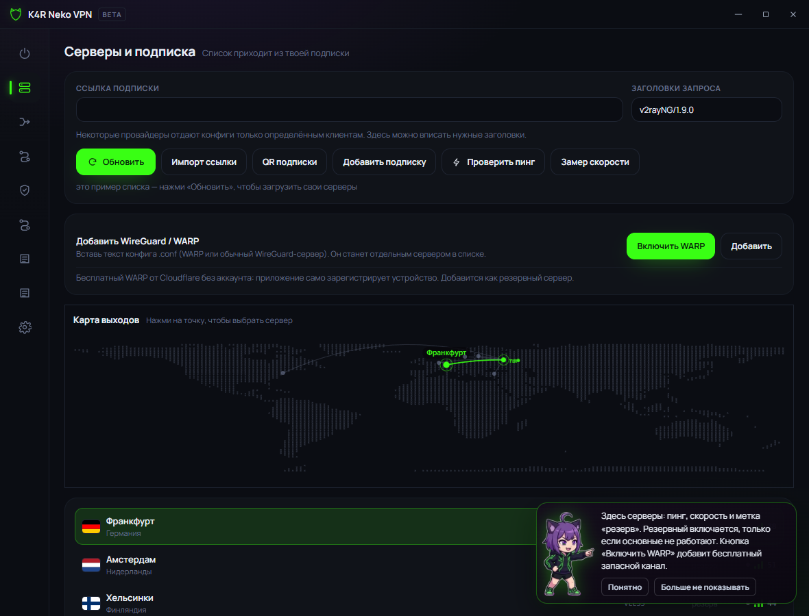</td>
    <td width="50%">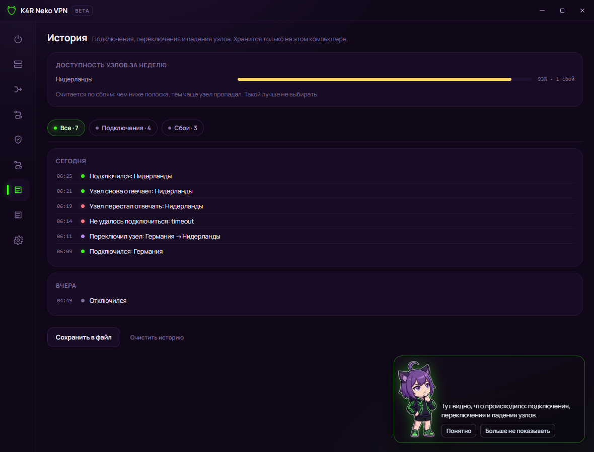</td>
  </tr>
  <tr>
    <td align="center"><sub>Подписки, карта выходов, поиск по серверам</sub></td>
    <td align="center"><sub>История: фильтр «все / подключения / сбои» и экспорт в Excel</sub></td>
  </tr>
</table>

<table>
  <tr>
    <td width="50%">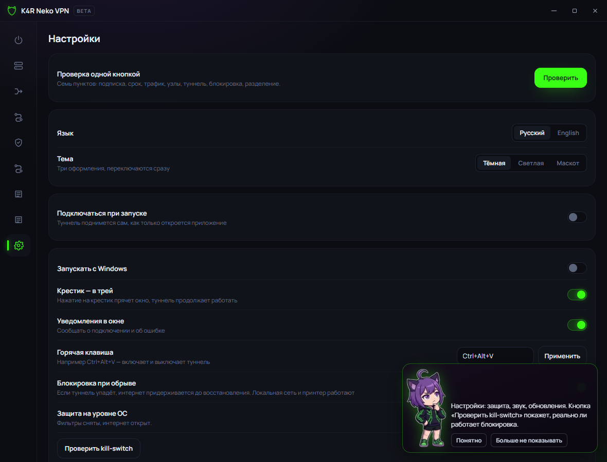</td>
    <td width="50%">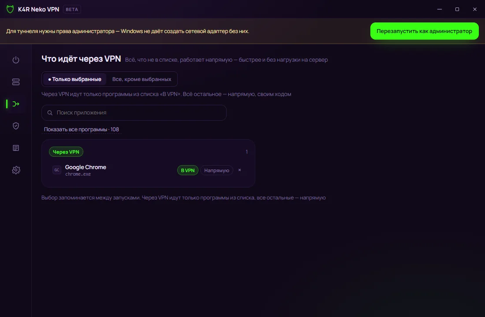</td>
  </tr>
  <tr>
    <td align="center"><sub>Настройки: проверка одной кнопкой, вид глобуса, трей</sub></td>
    <td align="center"><sub>Какая программа идёт через VPN</sub></td>
  </tr>
</table>

<p align="center">
  <sub>Все скриншоты — настоящий запущенный клиент. Ссылка подписки, адреса и пути
  заменены на вымышленные, список серверов — демонстрационный</sub>
</p>

<table>
  <tr>
    <td width="50%">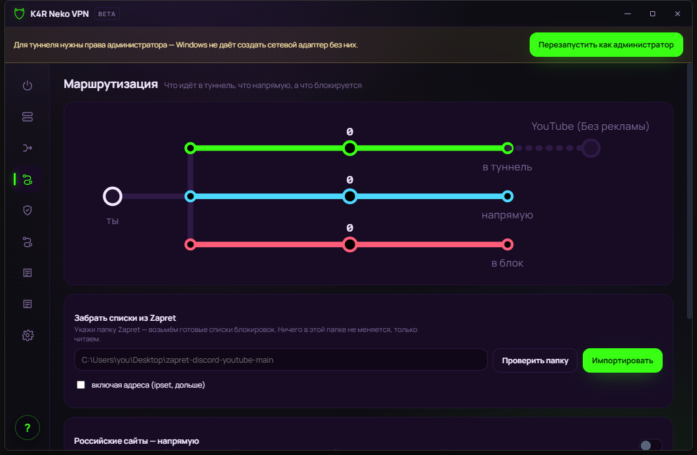</td>
    <td width="50%">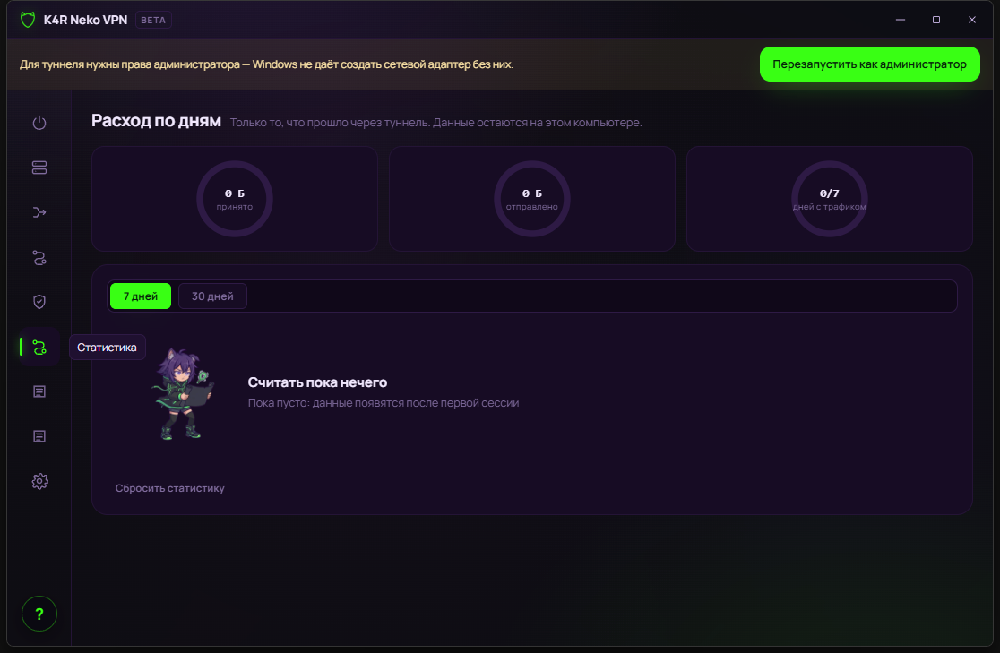</td>
  </tr>
  <tr>
    <td align="center"><sub>Маршрут: ты → правила → в туннель / напрямую / в блок</sub></td>
    <td align="center"><sub>Статистика: кольца трафика, пусто — так и пишет</sub></td>
  </tr>
</table>

## За 60 секунд

1. Скачать установщик, запустить, поставить (SmartScreen предупредит: сертификата
   подписи нет, «Подробнее» → «Выполнить в любом случае»).
2. Открыть «Серверы», вставить ссылку подписки от провайдера, нажать «Обновить».
3. Выбрать сервер в списке или на планете и нажать на планету — туннель поднимется.
4. Если что-то не работает — «Настройки» → «Проверка одной кнопкой»: шесть пунктов
   скажут, что именно, и отчёт можно скопировать.

Если серверов ноль — памятка по порядку проверок (ссылка, лимит устройств, срок,
формат ответа): [`docs/ПОДПИСКА-И-ЛИМИТ.md`](docs/ПОДПИСКА-И-ЛИМИТ.md).


## Android

> **Разработка Android переехала в отдельный репозиторий:
> [k4r-neko-vpn-android](https://github.com/Killer4Reals/k4r-neko-vpn-android).**
> Здесь остались описание и скриншоты Android-версии; исходники, история коммитов,
> скрипт сборки ядра и ADR-005 теперь там. Этот репозиторий — про Windows.

Тот же клиент нативно на Kotlin + Compose, ядро — тот же `sing-box`, но
библиотекой (`libbox.aar`, собран из исходников, см. `scripts/build-libbox.ps1`).
`VpnService`, разрешение на VPN, постоянное уведомление — родные API Android,
поэтому здесь нет ни WebView, ни прослойки JNI.

<p align="center">
  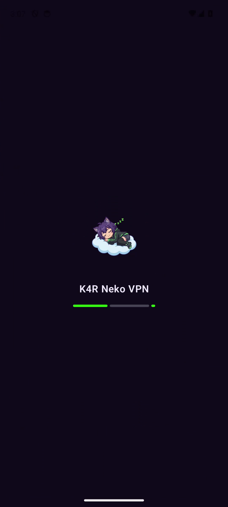
  <br><sub>Заставка: маскот спит на облаке — кадр с живого Android 14</sub>
</p>

<table>
  <tr>
    <td width="33%"></td>
    <td width="33%">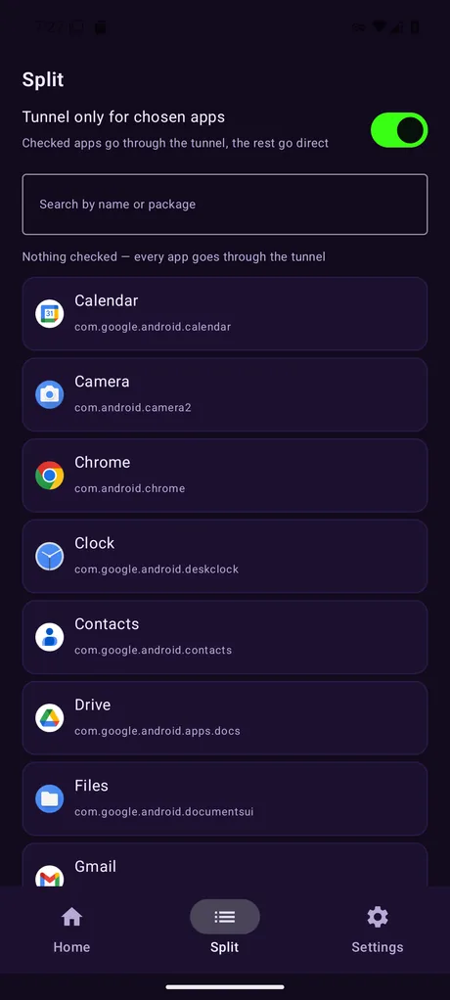</td>
    <td width="33%">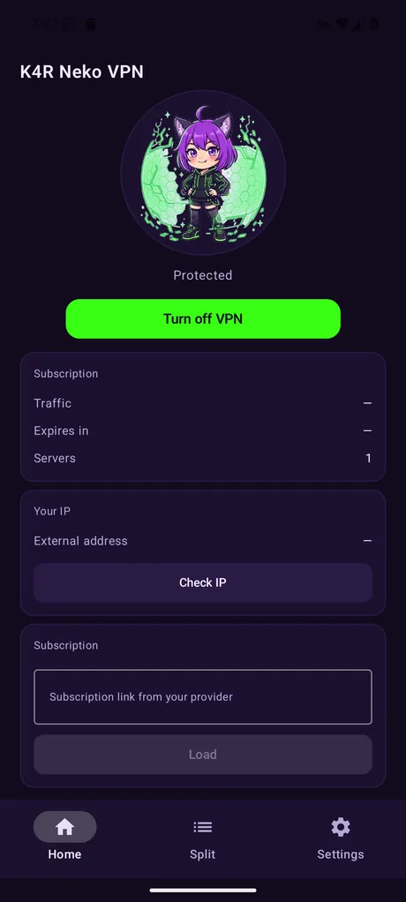</td>
    <td width="33%">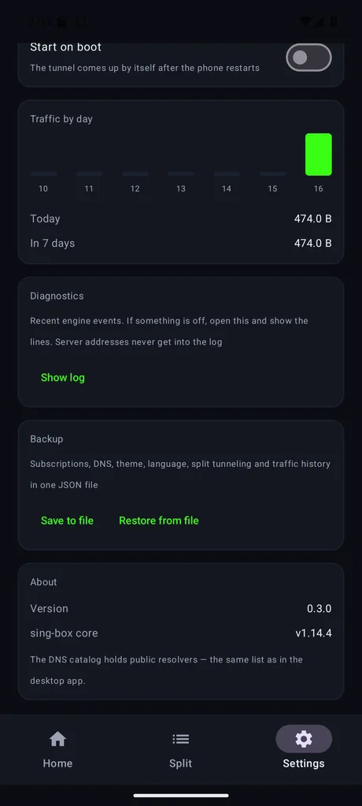</td>
  </tr>
  <tr>
    <td align="center"><sub>Маскот, состояние, подписка, «Твой IP»</sub></td>
    <td align="center"><sub>Живой список программ с иконками</sub></td>
    <td align="center"><sub>Язык, каталог DNS, звук регионов</sub></td>
    <td align="center"><sub>Трафик по дням, журнал, копия настроек</sub></td>
  </tr>
</table>

Что уже работает: туннель VLESS/REALITY через `sing-box` (проверено на настоящей
подписке — внешний адрес меняется на адрес сервера), честное состояние
«Защищено» только после живого ответа через туннель, подписка с разбором
`subscription-userinfo`, выбор сервера с откликом, перебор серверов при отказе,
разделение по приложениям, каталог DNS, блокировка IPv6, язык
интерфейса (система / русский / English).

**Подписка в любом виде**: sing-box JSON, Clash/Mihomo YAML (vless, trojan,
shadowsocks, vmess), ссылки `vless://`, `trojan://`, `ss://`, `vmess://` — пачкой
строк. Если провайдер дал узлы неподдержанного типа (hysteria2, tuic), приложение
честно пишет, сколько пропустило и каких.

**Защита при обрыве**: если туннель упал, трафик не уходит напрямую — приложение
держит VPN, который ничего не пропускает, и предлагает вернуть интернет кнопкой.
Когда сеть возвращается (вышел из метро, включил Wi-Fi), туннель поднимается сам.

Подписок может быть несколько: они лежат плашками на главной, переключаются одним
нажатием, а старая одиночная подписка переносится сама. Есть учёт трафика по
дням (столбики за неделю), спидтест через туннель, отклик всех серверов одной
кнопкой и резервная копия настроек в файл.

Есть автозапуск после перезагрузки и плитка в шторке, счётчики трафика от самого
ядра и журнал ядра в настройках. Ядро собрано под `arm64` и `amd64`, поэтому
этот же APK ставится на настоящий телефон.

Сборка — в репозитории [k4r-neko-vpn-android](https://github.com/Killer4Reals/k4r-neko-vpn-android):
там же `scripts/build-libbox.ps1` для ядра, `./gradlew testDebugUnitTest` и
`./gradlew assembleRelease`.

Release подписывается ключом из `keystore.properties` в репозитории приложения —
файла **нет в репозитории**, он лежит у владельца
(`%LOCALAPPDATA%\Android\keys\k4r-release.jks`). Без него `assembleRelease`
соберёт неподписанный APK: поставить его на телефон нельзя, и это видно сразу.
Ключ нельзя терять — обновления должны быть подписаны тем же ключом, иначе
Android откажется ставить новую версию поверх старой.

Готовый APK: `dist/K4R-Neko-VPN-1.35.3-android.apk` в репозитории Android (arm64 + amd64, 53 МБ).
Ставится на телефон как обычный APK; Play Protect спросит про незнакомый
источник — это ожидаемо, ключ самоподписанный.

## Что это умеет

- **Туннель.** VLESS/Reality/gRPC, подписки (несколько сразу), выбор сервера,
  проверка живости серверов, авто-выбор быстрого.
- **Умный пул узлов.** В одном запуске ядра до трёх серверов: ядро само меряет
  их и отдаёт трафик лучшему, а если узел умер — переключается на живой без
  разрыва и перезапуска. Отсюда и быстрое подключение, и автолечение.
- **Живая кривая скорости** на главной: последние сорок секунд, а не только
  цифра «сейчас».
- **Разделение по программам.** Два режима: «только выбранные» (в туннель идут
  лишь отмеченные программы) и «все, кроме выбранных». Локальная сеть остаётся
  локальной в любом режиме.
- **Маршрутизация по доменам и адресам.** Переключатели «российские сайты —
  напрямую» и «реклама и трекеры — в блок», плюс свои правила: домен, домен с
  поддоменами, слово в домене или подсеть (`CIDR`) → в туннель, напрямую или в
  блок. Порядок строк — порядок применения; свои правила важнее разделения по
  программам. Списки РФ и рекламы ядро скачивает и обновляет само.
- **Блокировка при обрыве.** Если движок падает, поднимается «держащий» режим:
  адаптер на месте, наружу ничего не уходит, локальная сеть работает.
- **Автовыбор сервера.** Выкл / 5 / 15 / 30 / 60 минут: замеряет все серверы и
  переключается, только если другой быстрее текущего на четверть. Активную закачку
  не рвёт. По умолчанию выключен.
- **Уходить с просевшего узла.** Отдельный тумблер: замер раз в 10 минут, и если
  текущий узел хуже лучшего больше чем на 40 мс — переключение с сообщением.
  Выключен по умолчанию: переключать человека за спиной нельзя.
- **Просадка скорости — тоже повод.** Пинг бывает хорошим, а канал мёртвым:
  если восемь секунд подряд скорость ниже 30% пика, приложение уходит на другой
  узел. Пауза между переключениями — 10 минут, чтобы не дёргать зря.
- **Watchdog.** Ядро живо, а туннеля нет две проверки подряд — перезапуск на
  другом узле, не больше трёх раз, с записью в журнал. Если не помогло — честный
  экран «все узлы мертвы»: время последней удачной проверки, «обновить подписку»
  и «проверить снова».
- **Игровой старт.** При включении игрового режима и при запуске игры из списка
  «программ через туннель» приложение само замеряет узлы и садится на самый
  быстрый. Снимок процессов — Toolhelp, без PowerShell и без опроса сети.
- **Сценарии.** «Игры» (быстрый узел при старте игры, без переключений посреди
  матча), «Стрим» (сам уходит с просевшего узла), «Работа» (через VPN только
  выбранные программы). Один клик ставит сразу несколько настроек, активный
  сценарий подсвечен по фактическим значениям, а не по нажатию.
- **История событий.** Подключения, переключения, отказы, падения и возвраты
  узлов — по времени и по дням. Плюс «доступность узлов за неделю»: видно, что
  узел моргает, до того как он подведёт. Хранится только на компьютере.
- **Проверка одной кнопкой.** Подписка, срок, трафик, узлы, туннель, блокировка
  при обрыве и ловушка «разделение включено, а список пуст». Отчёт копируется
  одной кнопкой, чтобы не описывать проблему словами.
- **Звук по регионам.** Азия — колокольчик, Европа — бас, Америка — две ноты
  вверх: слышно, куда подключился, не глядя на экран.
- **Турбина скорости.** Вместо голой цифры — арка, игла и живой след: видно
  не только «сколько», но и «как» качает.
- **Спарклайн задержки** в каждой карточке узла и пульс выбранного: узел,
  который начинает моргать, видно до подключения.
- **«Паспорт выхода».** Флаг, IP, страна, провайдер, протокол, задержка и
  оценка канала 0–100 — всё, что нужно, чтобы понять, куда ты попал.
- **Маршрут как схема метро.** Ты → правила → три линии: в туннель, напрямую,
  в блок. Не таблица галочек, а видно, куда что пойдёт.
- **Кольца статистики.** Трафик, время сессии, средняя скорость; если данных
  нет — «считать пока нечего», а не нули ради красоты.
- **Планета с живыми узлами.** Шар показывает точки узлов: зелёная — быстро,
  жёлтая — тормозит, оранжевая — медленно, красная — не ответил, серая — замер
  постарел. Наведение даёт «Франкфурт · 38 мс». Поворот к стране — плавный
  перелёт с зумом и кольцом прибытия.
- **Mica-подложка окна.** Windows 11 показывает обои сквозь окно, Windows 10
  остаётся с прежним тёмным фоном — без «псевдостекла» на неподдерживаемой системе.
- **Меню трея со статусом.** Первая строка — «Подключено / Ошибка / Выключено»,
  вторая — «Подключить / Отключить», ниже быстрый выбор сервера.
- **Kill-switch на уровне ОС (WFP).** Отдельный helper держит динамическую
  сессию фильтров в ядре Windows: защита переживает падение приложения. Правила
  узкие — loopback, локальная сеть, движок, TUN, резолвер; всё остальное
  блокируется. Аварийное снятие: `K4R Neko VPN.exe --wfp-off`
  (подробности и чек-лист — `docs/kill-switch.md`).
- **DNS с каталогом.** Четыре категории резолверов — «быстрые без фильтров»,
  «без рекламы и трекеров», «против вирусов и фишинга», «семейные», плюс свой
  адрес. У каждого три способа подключения: `DoH`, `DoT` и обычный IP.
  Есть поиск и строка «сейчас в настройках».
- **Флаги стран** в списке серверов: страна берётся из имени, которое прислал
  провайдер, а флаг — свой SVG, потому что Windows рисует флаги-эмодзи буквами.
- **Честные состояния.** «Защищено» показывается только тогда, когда движок
  действительно поднял адаптер; трафик берётся из счётчиков движка, а не
  рисуется случайными числами; сервер, который не ответил, помечается
  «не отвечает».
- **Подписка обновляется сама** — интервал 1–48 часов, серверы перепроверяются
  при каждом открытии списка, мёртвые честно помечаются.
- **Мелочи, без которых неудобно.** Автопереподключение, горячая клавиша,
  крестик и «свернуть» в трей, карточка-уведомление в углу окна, автозапуск,
  обновление подписки по расписанию (1–48 ч), экспорт истории в файл, поиск по
  серверам, локализация ru/en.
- **Онбординг первого запуска** — три карточки с маскотом поверх главного экрана:
  пропустить можно сразу, а после первого запуска он больше не появляется.
- **Диагностика одним zip.** Кнопка в «Журнале» собирает журналы движка и защиты
  плюс короткую сводку окружения в один архив в «Загрузках». Ключи, адреса и
  подписка в архив не попадают.
- **Память узла по сети.** «Дома — этот, в кафе — тот»: приложение запоминает
  выбранный узел для шлюза сети, а не для имени Wi-Fi, и возвращает его при
  следующем подключении.
- **Перенос профиля ПК ↔ Android.** QR-ссылка `k4r://` на экране «Серверы» и
  вставка её на телефоне — без копирования длинного адреса руками.
- **Zapret под нашим управлением.** Пресет можно поднимать вместе с приложением
  («Запускать вместе с приложением»), отдельная программа Zapret не нужна;
  чужой запущенный `winws2` не трогается. Приложение не зависит от Zapret и не трогает
  чужой `winws2`: показывает его реальное состояние и оставляет чужой запуск в
  покое.

## Что проверено вживую

| Проверка | Результат |
| --- | --- |
| Программа из списка «В VPN» | выходит через VPN-адрес |
| Программа не из списка, в ту же минуту | остаётся на адресе провайдера |
| Блокировка при обрыве | наружу недоступно, локальная сеть жива |
| Переподключение после падения движка | ~2 секунды, трафик продолжается |
| Счётчики трафика | 20 МБ скачано → счётчик вырос на 20 121 810 байт |
| Сворачивание в трей | окно скрывается, процесс жив |
| Установщик | тихая установка, запуск, тихое удаление без следов |
| Mica на Windows 11 | окно показывает обои, лог `подложка окна: mica` |
| Буфер обмена | читается только по кнопке; при входе в «Серверы» запроса доступа больше нет |
| Релиз 1.50.0 | установщик и портативный zip запускаются, интерфейс цел |

Подробности — в `docs/ОТЧЁТ-0.4.md`, решения — в `docs/adr/`.

Если подписка не загружается и серверов ноль — короткая памятка по порядку
проверок (ссылка, лимит устройств, срок, формат ответа):
[`docs/ПОДПИСКА-И-ЛИМИТ.md`](docs/ПОДПИСКА-И-ЛИМИТ.md).

## Устройство

```
app/                  приложение
  src/                интерфейс: React + TypeScript, шесть экранов
  src-tauri/          ядро на Rust
    src/engine.rs     конфиг движка, запуск, надзор, блокировка при обрыве
    src/subscription.rs  разбор подписок (VLESS, base64, JSON)
    src/probe.rs      проверка живости серверов
    src/store.rs      настройки и состояние
    src/zapret.rs     чтение состояния чужого Zapret, без вмешательства
art/                  маскот и иконки: исходники, вырезание, оптимизация
docs/                 отчёты и ADR
```

Ключевые решения:

- [ADR-001](docs/adr/ADR-001-architecture.md) — почему Tauri и Rust.
- [ADR-002](docs/adr/ADR-002-split-tunneling.md) — разделение по программам.
- [ADR-003](docs/adr/ADR-003-route-order.md) — порядок правил маршрутизации.
- [ADR-004](docs/adr/ADR-004-kill-switch.md) — блокировка при обрыве без правки
  системных правил.
- [ADR-006](docs/adr/ADR-006-sam-sledit.md) — автоподключение, сторож сети и
  переключение сервера при деградации.

## Сборка

Нужны Rust (stable), Node 20+ и WebView2 (в Windows 11 уже есть).

```bash
cd app
npm install
npm run tauri dev      # разработка
npm run tauri build    # установщик NSIS и exe
```

Движок `sing-box.exe` лежит в `app/src-tauri/resources/bin/` и кладётся рядом с
приложением при сборке. Портативная версия — папка целиком, без установки.

## Тесты

156 тестов ядра, 250 тестов интерфейса, 308 тестов Android (в его репозитории).

Числа не украшение: правила замеров живут в одном модуле (`app/src/health.ts` и
`data/Health.kt`) и проверяются с обеих сторон, поэтому список серверов, точки на
планете и автопереключение не могут разойтись.

```bash
cd app/src-tauri
cargo test                       # конфиг, правила, разбор подписок, хранилище,
                                 # сторож одного экземпляра, ротация журнала,
                                 # автоподключение, смена сети, деградация
cargo run --example hold_probe      # блокировка при обрыве
cargo run --example whitelist_probe # разделение по программам
```

Пробы поднимают настоящий туннель на несколько секунд и сами его гасят.

## Приватность

Приложение не отправляет телеметрию. Наружу уходят только запросы к серверу
подписки и к самому VPN-серверу. Журнал и настройки лежат локально в
`%APPDATA%\ink.k4r.nekoneko.vpn` (Roaming: так это делает Tauri). В репозитории нет ни ссылок на подписки, ни
идентификаторов устройств, ни личных путей.

## Лицензия

Все права сохранены. Код открыт для чтения, но не для распространения или
переиспользования без разрешения автора.

## Движок

`sing-box.exe` в репозитории не хранится. Перед первой сборкой:

```powershell
powershell -ExecutionPolicy Bypass -File scripts/fetch-engine.ps1
```

Скрипт скачивает официальный релиз sing-box для Windows в
`app/src-tauri/resources/bin/`.
